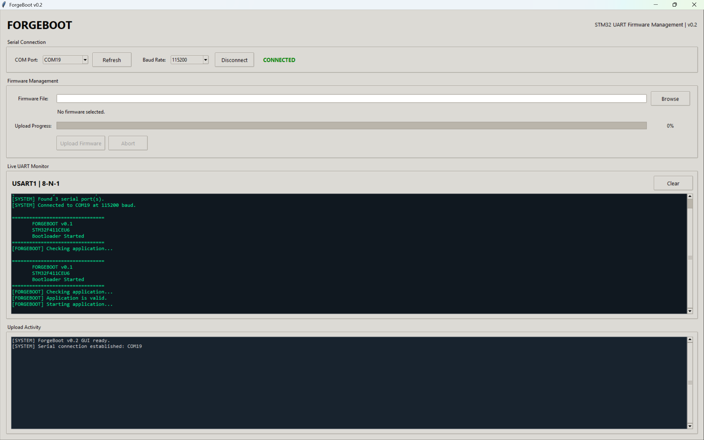
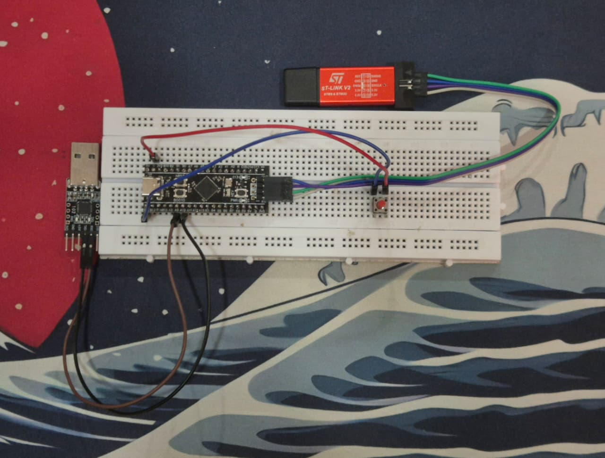
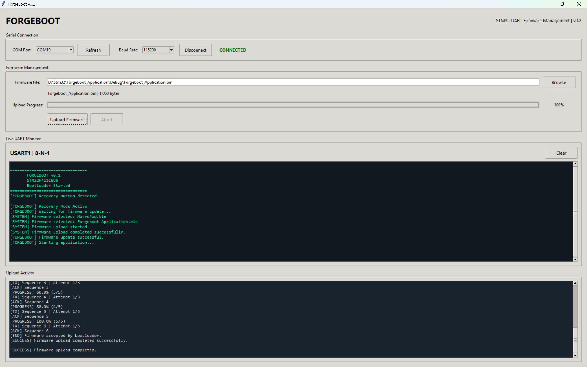
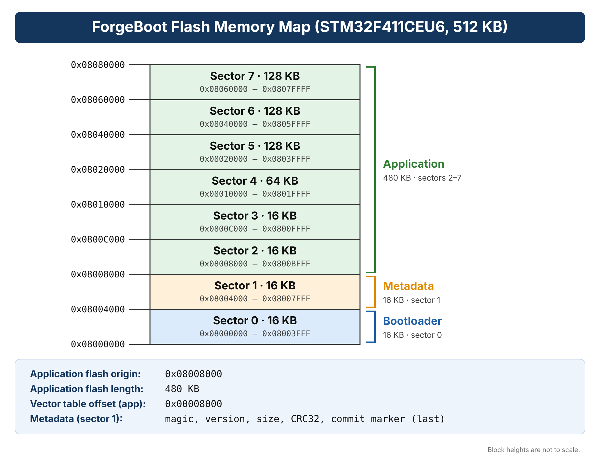

# ForgeBoot v0.2

A UART-based firmware bootloader for the **STM32F411CEU6** (512 KB Flash, 128 KB SRAM), with a Python desktop uploader/serial monitor and a command-line uploader.

ForgeBoot keeps the bootloader in a protected Flash region, receives application images over UART, validates them with CRC32, stores application metadata, and launches a successfully installed application.

> **Hardware-validated target:** STM32F411CEU6 Black Pill. The documented pinout and memory map are specific to this target; do not assume compatibility with other STM32 variants without adapting and testing the firmware.

## Features

- UART firmware update protocol at **115200 baud, 8-N-1**.
- Packet synchronization, sequence numbers, CRC32, ACK/NACK responses and retransmission support in the host uploader.
- Recovery-mode detection from the GUI using the PING command before upload begins.
- Firmware image validation, Flash programming and metadata commit.
- Transfer cancellation/recovery using ABORT.
- Automatic application launch after a successful update.
- Application handoff cleanup, including vector table relocation and interrupt-state handling.
- Tkinter desktop GUI with serial monitor, firmware selection, upload progress and activity log.
- Separate command-line uploader and offline protocol self-tests.
- PB12 recovery button to enter update mode on startup.

## Repository layout

```text
ForgeBoot/
├── firmware/
│   └── Forgeboot_Bootloader/   # STM32CubeIDE project
├── host/
│   ├── forgeboot_gui.py        # Desktop GUI
│   ├── forgeboot_backend.py    # Shared protocol/uploader backend
│   └── forgeboot_uploader.py   # Command-line uploader
├── docs/
│   ├── hardware_setup.md
│   ├── protocol.md
│   └── release_notes_v0.2.md
├── requirements.txt
├── CHANGELOG.md
├── LICENSE
└── .gitignore
```

## Project images

### ForgeBoot desktop GUI



### Hardware requirements

To build, initially program, and use ForgeBoot v0.2, the following hardware is required:

| Component | Requirement / purpose |
|---|---|
| STM32F411CEU6 Black Pill | Target board running ForgeBoot and the user application |
| ST-LINK V2 (or compatible SWD programmer) | Required to initially flash/debug the bootloader at `0x08000000`; not needed for routine UART firmware updates |
| USB-to-UART adapter (e.g. CP2102) | Connects the board's USART1 to the PC for firmware uploads and serial monitoring |
| USB cable and suitable 5 V supply | Powers the development board; use the board's supported power input |
| Momentary pushbutton | Connects PB12 to GND to request recovery mode at startup |
| Jumper wires | UART, ground, and recovery-button connections |
| PC running Python 3.8+ | Runs the ForgeBoot GUI or command-line uploader |

**Logic-level requirement:** the USB-to-UART adapter must use 3.3 V UART logic. Do not connect 5 V UART signals to the STM32 pins. If the board is powered separately, leave the adapter's VCC pin disconnected; connect grounds together.

## Hardware connections



### Successful firmware upload



### Flash memory map



## Hardware connections

| STM32F411CEU6 | USB-UART adapter / control | Notes |
|---|---|---|
| PA9 | Adapter RX | USART1 TX, AF7 |
| PA10 | Adapter TX | USART1 RX, AF7 |
| GND | Adapter GND | Common ground required |
| PB12 | Momentary button to GND | Active-low recovery input; internal pull-up enabled |
| 3V3 logic | Adapter UART logic | Use 3.3 V-compatible UART signaling |

Do not connect the adapter's 5 V UART logic to the STM32 pins. The USB-UART adapter and STM32 must share ground. The adapter's VCC pin is not required when the board is powered separately.

## Enter recovery mode

1. Connect the USB-UART adapter using the pinout above.
2. Hold the recovery button (PB12 connected to GND).
3. Reset or power-cycle the STM32 while holding the button.
4. Release the button after startup. The bootloader reports that recovery mode is active and waits for firmware packets.
5. Connect the host GUI to the adapter's COM port at 115200 baud.

If the button is not pressed at startup, ForgeBoot validates the installed application and launches it when valid. If no valid application is present, it enters recovery mode.

## Build the bootloader firmware

1. Install **STM32CubeIDE** with STM32F4 device support and the GNU Arm Embedded toolchain.
2. In STM32CubeIDE, choose **File → Import → Existing Projects into Workspace**.
3. Select the `firmware/Forgeboot_Bootloader` directory and import the project.
4. Select the `Debug` configuration and build the project.
5. The generated ELF/BIN files appear in the project's `Debug` output directory.
6. Program the bootloader BIN/ELF at **`0x08000000`** using an ST-LINK/SWD programmer.

The project includes its STM32CubeIDE project metadata, linker scripts, startup file, CMSIS headers and STM32F4 HAL sources. The project uses the STM32F411CEUx target and a 16 MHz CPU-clock setting for the debugger configuration.

> The release source archive intentionally excludes generated `Debug` output. Build locally to generate a fresh bootloader binary. Do not use an old build artifact as proof that the current source was rebuilt.

## Install the Python host application

Python 3.8 or newer is recommended. From the repository root:

```bash
python -m pip install -r requirements.txt
```

Launch the GUI:

```bash
python host/forgeboot_gui.py
```

The GUI lets you select the serial port, connect, monitor UART output, select an application `.bin`, and upload it. Before sending an update, it sends PING and requires a matching ACK. If recovery mode is not detected, the GUI blocks the upload so that a normal running application is not accidentally treated as the bootloader.

### Command-line uploader

```bash
python host/forgeboot_uploader.py --help
```

Example upload (check `--help` for the exact options supported by the CLI):

```bash
python host/forgeboot_uploader.py --port COM19 --upload path\to\application.bin
```

Run the backend's offline tests:

```bash
python host/forgeboot_backend.py --self-test
```

## Application compatibility: custom firmware

ForgeBoot is not limited to a single application written specifically for this bootloader. An independently developed STM32F411CEU6 application can be uploaded and launched when it is linked for ForgeBoot's application region and follows the normal Cortex-M startup/vector-table conventions.

**Verified compatibility demonstration:** a separately maintained macropad firmware project was built independently, configured for the ForgeBoot application address, uploaded through the ForgeBoot GUI, and launched successfully. The macropad source remains in its own repository and is not bundled here.

Configure an application project as follows:

| Setting | Required value |
|---|---:|
| Flash origin | `0x08008000` |
| Flash length | `480K` |
| Vector table offset | `0x00008000` |
| Output image | Raw `.bin` |

For a typical STM32CubeIDE application linker script:

```ld
FLASH (rx) : ORIGIN = 0x08008000, LENGTH = 480K
```

In the application's `system_stm32f4xx.c`, set the vector-table offset to:

```c
#define VECT_TAB_OFFSET 0x00008000U
```

Ensure the application's `SystemInit()` applies the vector table base plus this offset (for this layout, `0x08008000`). The application should initialize its own clock tree and peripherals; it must not assume the bootloader's peripheral configuration remains active after handoff.

Build the application and convert its ELF file to a binary if the IDE does not already generate one:

```bash
arm-none-eabi-objcopy -O binary Application.elf Application.bin
```

Select that `.bin` in the ForgeBoot GUI and upload while the device is in recovery mode. The image must fit in the 480 KB application region.

## Flash memory map

| Region | Address range | Size | Purpose |
|---|---|---:|---|
| Sector 0 | `0x08000000–0x08003FFF` | 16 KB | Bootloader; protected from application erase/program operations |
| Sector 1 | `0x08004000–0x08007FFF` | 16 KB | Application metadata |
| Sectors 2–7 | `0x08008000–0x0807FFFF` | 480 KB | Application image |

Application SRAM is `0x20000000–0x2001FFFF` (128 KB), with the initial stack pointer expected within that range (top of SRAM: `0x20020000`).

**Important update behavior:** beginning a new update erases the application region. This is a single-slot design; it does not preserve a previous working application for rollback. If an update is interrupted, the bootloader remains available and another upload can be attempted, but the previous application may already have been erased.

## UART protocol

See [`docs/protocol.md`](docs/protocol.md) for packet framing, commands, response codes and transfer sequence.

## Limitations and security notes

- CRC32 detects accidental corruption; it is **not** cryptographic authentication.
- Firmware images are not digitally signed or authenticated.
- There is no dual-image rollback slot.
- The current implementation targets STM32F411CEU6 and its documented Flash layout.
- A failed/invalid application does not overwrite the bootloader sector through the normal application update path, but recovery depends on the hardware and bootloader remaining functional.

## License

ForgeBoot project code is released under the MIT License. Third-party STMicroelectronics/CMSIS components retain their respective license terms and notices in the `Drivers` directory. See [`LICENSE`](LICENSE), [`THIRD_PARTY_NOTICES.md`](THIRD_PARTY_NOTICES.md), and the included third-party license files.
